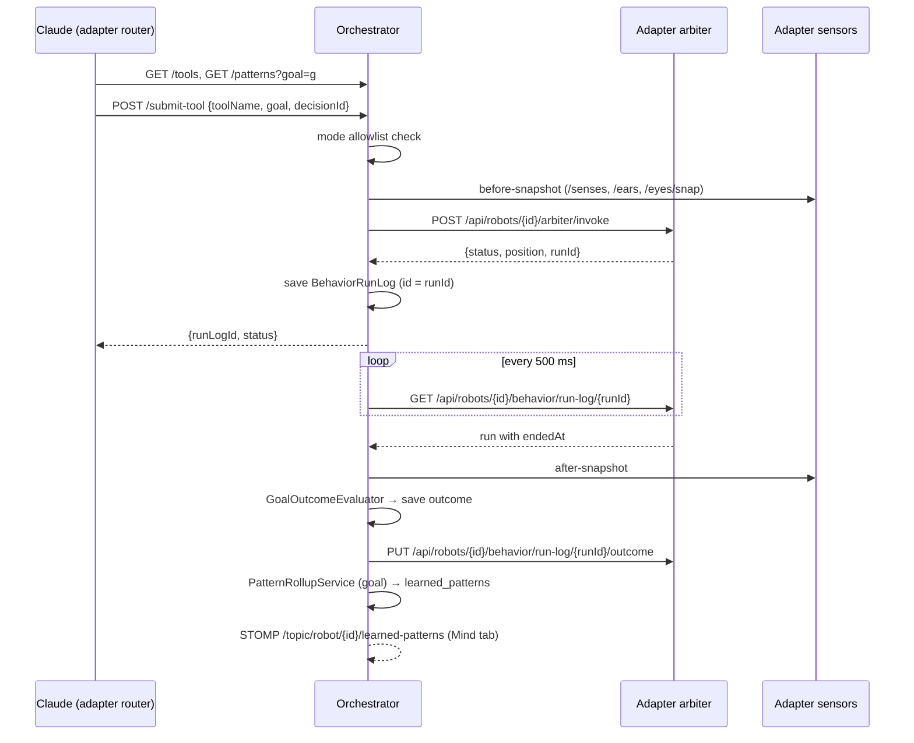

# Agent Tool Composition API

As built by AGENT-01 … AGENT-18 (2026-10-11). Design background:
[`design/AGENT_TOOL_COMPOSITION_DESIGN.md`](../design/AGENT_TOOL_COMPOSITION_DESIGN.md);
where that design and this page disagree, this page follows the code. The
machine-readable spec for the orchestrator endpoints is
[`openapi.json`](openapi.json) (tag **Agent**; served live at `/v3/api-docs`
and `/swagger-ui.html`).

The agent (Claude, through the adapter's stationary-assistant LLM router)
picks **tools** — named behaviors — for a declared **goal**. The orchestrator
sends each tool call to the robot's arbiter at priority 3, watches the run
finish, judges from sensor snapshots whether the goal was reached, and keeps
per-goal statistics of which **tool combinations** work. The agent reads those
**learned patterns** before its next decision.

## 1. Orchestrator endpoints (`/api/v1/agent/{robotId}`)

All responses are JSON. Errors use the orchestrator's envelope
`{"error": "<code>", "message": "<text>"}`.

### 1.1 `GET /api/v1/agent/{robotId}/tools`

Tools the agent may call in the robot's current operating mode (stationary
when no mode was ever set).

| Mode | Tools |
|---|---|
| `stationary` | `look_left`, `look_right`, `look_upward`, `tilt_head`, `bark`, `sit`, `stand` |
| `roaming` | `move_forward`, `move_backward`, `turn_left`, `turn_right` + all stationary tools |
| `fruitfly`, `phone` | none |

```http
GET /api/v1/agent/bittle-1/tools
```
```json
[
  {"name": "look_left", "description": "Face left", "category": "postural"},
  {"name": "look_right", "description": "Face right", "category": "postural"},
  {"name": "look_upward", "description": "Face upward", "category": "postural"},
  {"name": "tilt_head", "description": "Tilt head to one side", "category": "postural"},
  {"name": "bark", "description": "Bark once", "category": "vocal"},
  {"name": "sit", "description": "Sit down", "category": "postural"},
  {"name": "stand", "description": "Stand up", "category": "postural"}
]
```
`category` is `postural`, `locomotive` or `vocal`. The lists are fixed per
mode; only the robot's mode is read per request, so a mode switch shows at once.

### 1.2 `GET /api/v1/agent/{robotId}/patterns?goal={goal}`

Active learned patterns for one goal, highest `successRate` first (ties: more
`attempts` first). Cached per robot + goal for 5 seconds.

```http
GET /api/v1/agent/bittle-1/patterns?goal=look_upward
```
```json
[
  {"toolCombination": ["tilt_head", "look_upward"], "successRate": 0.9166666666666666,
   "attempts": 12, "successes": 11,
   "lastUsed": "2026-10-11T21:00:00Z", "firstDiscovered": "2026-10-10T18:12:07Z"},
  {"toolCombination": ["look_upward"], "successRate": 0.15, "attempts": 20, "successes": 3,
   "lastUsed": "2026-10-11T21:01:00Z", "firstDiscovered": "2026-10-09T09:30:00Z"}
]
```
An empty array means nothing has been learned for that goal yet.

### 1.3 `POST /api/v1/agent/{robotId}/submit-tool`

Run one tool for a goal.

```http
POST /api/v1/agent/bittle-1/submit-tool
Content-Type: application/json

{"toolName": "look_upward", "goal": "look_upward",
 "decisionId": "7c9e6679-7425-40de-944b-e07fc1f90ae7"}
```
| Field | Required | Meaning |
|---|---|---|
| `toolName` | yes | a tool from 1.1 |
| `goal` | no | what the call should achieve; without it the run gets no outcome judgement and is not learned from |
| `decisionId` | no | UUID shared by **every** tool call of one agent decision; the calls of one decision form one tool combination. A fresh one is generated when missing |

Accepted:
```json
{"runLogId": "0f8fad5b-d9cb-469f-a165-70867728950e", "status": "queued",
 "message": null, "position": 1}
```
Rejected (still HTTP 200):
```json
{"runLogId": null, "status": "rejected",
 "message": "Tool 'move_forward' is not available in stationary mode; available: look_left, look_right, look_upward, tilt_head, bark, sit, stand",
 "position": null}
```
`status` is `executing` (started now), `queued` (behind other runs at
`position`), `preempting` (interrupting a lower-priority run) or `rejected`.

### 1.4 Error codes and recovery

| Where | Code / message | Cause | What the caller should do |
|---|---|---|---|
| any | HTTP 404 `robot_not_found` | unknown `robotId` | fix the id (`GET /api/fleet/robots`) |
| patterns | HTTP 400 `bad_request` "goal is required" / missing `goal` | blank or missing goal | send a goal |
| submit | HTTP 400 `bad_request` "decisionId must be a UUID: …" | malformed decisionId | send a UUID or omit it |
| submit | `rejected` "toolName is required" | blank tool | pick a tool from 1.1 |
| submit | `rejected` "Tool 'x' is not available in *mode* mode; available: …" / "(no agent tools in this mode)" | mode allowlist (checked before the arbiter) | re-read 1.1 and choose from it; in fruitfly/phone do not move |
| submit | `rejected` "Operating mode unavailable; …" | mode could not be read | retry later; nothing was sent to the robot |
| submit | `rejected` "Connection error: …" | adapter unreachable / timed out | retry later; the robot did not move |
| submit | `rejected` "Adapter returned HTTP n: …" / "Invalid adapter response: …" / "Empty arbiter response" | adapter answered with an error or garbage | retry once; report if it persists |
| submit | `rejected` "behavior not found" | the adapter's behavior store has no behavior with that name | the tool is not installed on this robot; choose another |
| submit | `rejected` "cooldown" / "already running" / "already queued" / "queue full" | arbiter duplicate and rate guards | wait for the running/queued run, then try again; do not resubmit in a loop |

A rejected call creates no run-log entry and is never evaluated.

## 2. Data model

| Object | Fields |
|---|---|
| `ToolDescriptor` | `name`, `description`, `category` |
| `LearnedPatternDTO` | `toolCombination` (ordered tool names), `successRate` (0–1), `attempts`, `successes`, `lastUsed`, `firstDiscovered` |
| `ToolCallRequest` | `toolName`, `goal`, `decisionId` |
| `ToolCallResponse` | `runLogId` (UUID), `status`, `message`, `position` |
| `BehaviorRunLog` (stored, Postgres `behavior_run_logs`) | `id` (= arbiter run id), `robotId`, `timestamp`, `completedAt`, `behaviorName`, `source` = `agent`, `priority` = 3, `cause` = `{"type": "agent", "decisionId"}`, `executionTimeMs`, `preemptedBy`, `goal`, `outcome`, `sensorDelta` |
| `OutcomeEvaluation` | `success` (true / false / **null = undetermined**), `confidence` (0–1), `reason`, `evaluatorVersion` (`1.0`), `evaluatedAt` |
| `LearnedPattern` (stored, `learned_patterns`, unique per robot + goal + combination) | statistics as in the DTO, `status` `active` / `inactive` |

**How patterns are counted.** Runs of one `decisionId` (start order) are one
attempt of that combination; the attempt succeeds when its **last** run's
outcome is `success = true`. Attempts whose last outcome is undetermined
(no checker, missing sensor data, preempted, stale) are not counted. A
combination that disappears (a decision later gained another tool) is reset
and marked `inactive`, which hides it from 1.2.

**Goals with a checker** (thresholds under `agent.outcome.*`): `look_upward`,
`look_left`, `look_right` (camera motion centroid, head IMU as fallback),
`move_forward` (odometry along the starting heading, ≥ 5 cm), `listen_to_sound`
(audio amplitude rise), `bark` (audio peak + dominant frequency 250–2000 Hz),
`tilt_head` (IMU roll ≥ 10°). Any other goal is stored but judged undetermined.
Today the adapter serves odometry and audio level; camera centroid, IMU
pitch/roll and dominant frequency are not served yet, so the look/tilt goals
and the bark band check stay undetermined until they are.

## 3. Lifecycle



A run with no completion after `agent.run-stale-after-minutes` (10) is closed
as undetermined; a preempted run is undetermined too.

## 4. Integration guide for Claude (the adapter side)

`dog/app/agent_client.py` (`AgentToolsClient`) does this for the stationary
assistant (`ConversationService`) once `ORCHESTRATOR_URL` is set:

1. Ask `GET /tools` (cached 5 s) and offer those tools to the LLM router next
   to the voice.intent tools; a voice.intent tool with the same name wins.
2. When the router picks an agent tool, use the tool name as the goal and ask
   `GET /patterns?goal=…`. If the best pattern has **≥ 3 attempts at ≥ 50 %**
   and all its tools are allowed now, run that combination instead of the
   single tool.
3. Generate one `decisionId` (UUID) and `POST /submit-tool` each tool of the
   combination in order with it.
4. `executing` / `queued` / `preempting` → carry on (say the reply).
   `rejected`, an HTTP error or no answer → stop the sequence and say "I can't
   do that right now."; the message is kept on the conversation turn.
5. Never retry a rejected call in a loop (see 1.4).

## 5. Adapter (Python) endpoints used by the orchestrator

Robot-scoped (`/api/robots/{robotId}/…`; another robot id → 404
`unknown_robot`).

| Method & path | Used by | Body / answer |
|---|---|---|
| `POST /arbiter/invoke` | `ArbiterClient.submit` | `{"behavior", "source": "agent", "priority": 3, "decisionId", "goal"}` → `{"robotId", "behavior", "status", "position", "runId"}` or `{"status": "rejected", "reason"}`. The goal is stored in the run's `cause`. |
| `GET /behavior/run-log/{run_id}` | `ArbiterClient.getRunLog` | `{"id", "behavior", "source", "priority", "status", "detail", "cause", "preemptedBy", "startedAt", "endedAt", "outcome", "sensorDelta"}`; 404 `not_found` until the run has started |
| `PUT /behavior/run-log/{run_id}/outcome` | `ArbiterClient.syncOutcome` | `{"success", "confidence", "reason", "evaluator_version", "evaluated_at"?, "sensor_delta"?}` (camelCase accepted) → `{"status": "updated", "run"}`; idempotent; 400 invalid body, 404 unknown run |
| `GET /senses`, `GET /ears`, `GET /eyes/snap` | `SensorStateService` | pose (m, heading), audio level peak, JPEG frame |

## 6. Observability

- Metrics (`/actuator/metrics`): `bittle.agent.submissions` (tool, result),
  `bittle.agent.outcomes` (goal, result), `bittle.agent.pattern.rollup`
  (timer per goal), `bittle.agent.pattern.rollup.patterns`,
  `bittle.agent.pattern.rollup.failures`.
- STOMP `/topic/robot/{robotId}/learned-patterns`:
  `{"robotId", "goal", "rolledUpAt", "patterns": [LearnedPatternDTO…]}` after
  every rollup; shown on the Mind tab ("What she has learned").
- Logs: submissions and refusals (`AgentBehaviorService`), outcomes per run,
  pattern discoveries and success-rate changes (`PatternRollupService`).

## 7. Configuration

| Property / env | Default | Meaning |
|---|---|---|
| `arbiter.connect-timeout-ms` / `read-timeout-ms` | 2000 / 5000 | orchestrator → adapter arbiter calls |
| `agent.polling-enabled` | true | completion polling on/off |
| `agent.poll-interval-ms` | 500 | delay between polling passes |
| `agent.poll-batch-size` | 20 | pending runs per pass |
| `agent.run-stale-after-minutes` | 10 | close runs that never report completion |
| `agent.sensor-snapshot-ttl-minutes` | 10 | snapshot cache lifetime |
| `agent.outcome.*` | see `application.yml` | checker thresholds |
| `ORCHESTRATOR_URL` (adapter env) | empty = off | where the adapter finds the agent API |
| `AGENT_TIMEOUT_S` (adapter env) | 2.0 | adapter → orchestrator timeout |
